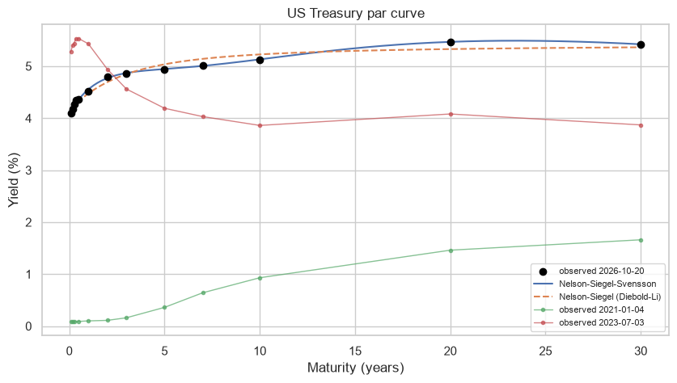
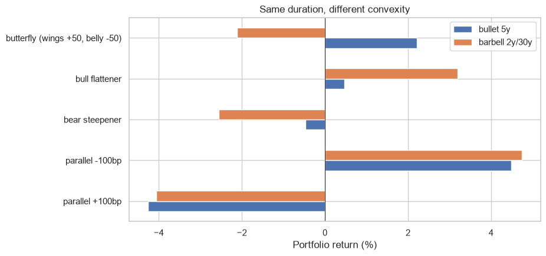

# US Treasury yield curve: Nelson-Siegel, PCA and bond risk

Nelson-Siegel for every day since 1990, Svensson for today's curve, PCA of the daily changes, and a bullet vs barbell portfolio under different curve scenarios.

## Data
Daily Treasury Par Yield Curve Rates (U.S. Department of the Treasury), 9.207 days.

## Main results
- Nelson-Siegel with fixed lambda fits with a median error of 8.4 bp, and the factors have correlation of 0.97 to 0.995 with level, slope and curvature of the curve.
- Svensson fits today's curve with 2.6 bp of error.
- PCA: the first 3 components explain 95.5% of the daily changes (level 75.6%).
- Same duration but different convexity: the barbell wins in parallel shifts and in a bull flattener, the bullet wins in a bear steepener and in the butterfly.




## How to run

```
pip install -r requirements.txt
jupyter notebook treasury_yield_curve.ipynb
```

---
Alejandro Lezcano Osorio | Universidad EIA (Colombia) and Rennes School of Business (France)
